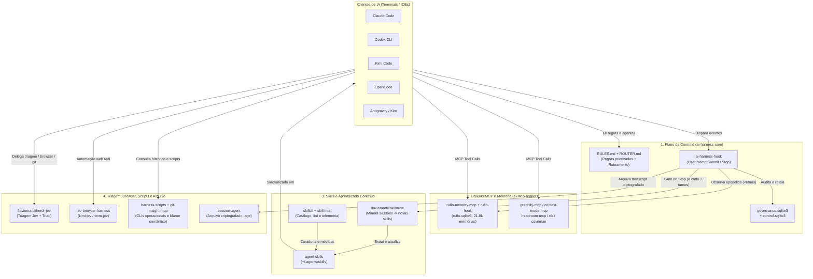
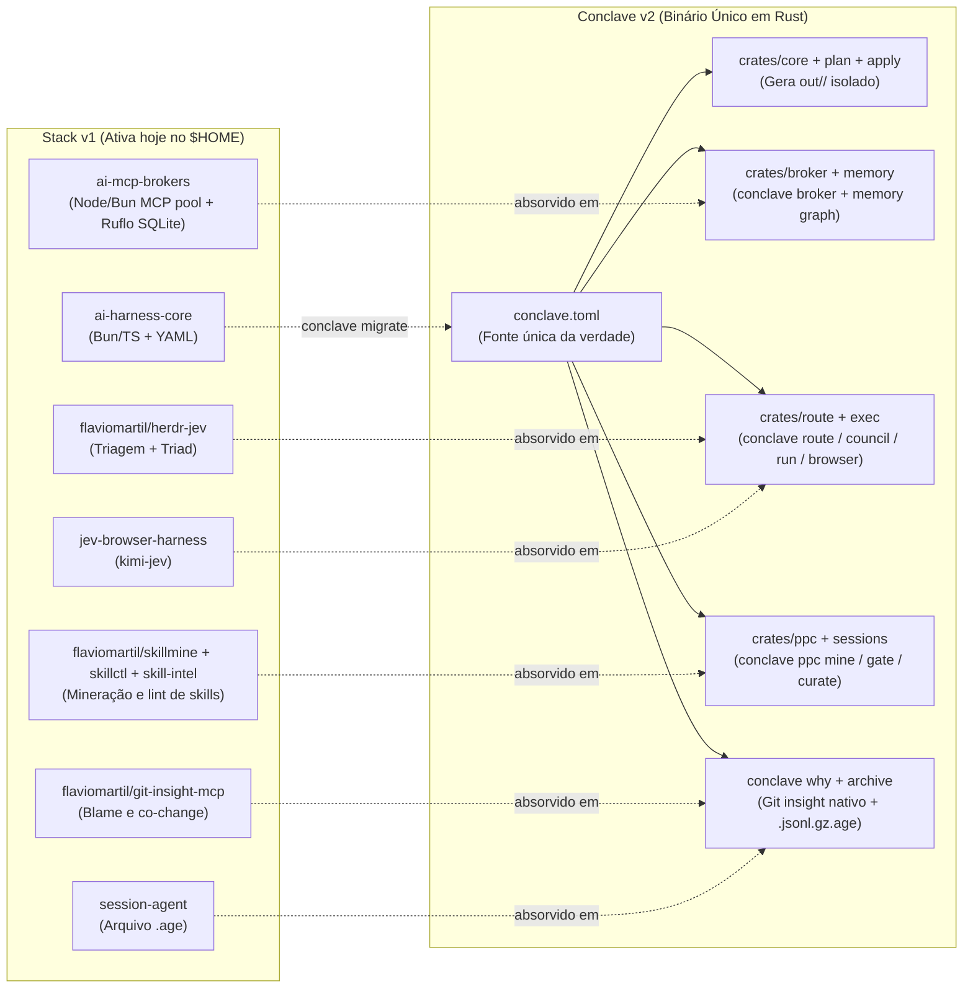

# AI Harness Labs

Plano de controle unificado, brokers MCP compartilhados, memória persistente SQLite (Ruflo) e catálogo de skills para orquestrar agentes de código (**Claude Code**, **Codex CLI**, **Kimi Code**, **OpenCode**, **Antigravity** e **Kiro**) no mesmo ambiente.

---

## Como tudo se conecta (Visão Geral)



---

## Stack Atual (v1) vs Conclave (v2 em Rust)

O `conclave` consolida os repositórios v1 em **um único binário Rust** (`/home/martil/.local/bin/conclave`) e **um único arquivo declarativo** (`conclave.toml`), sem espalhar wrappers e instalações manuais pelo `$HOME`.



| O que você faz na Stack v1 (Ativa no `$HOME`) | Equivalente no `conclave` (v2 Rust) | Como eles convivem hoje |
| :--- | :--- | :--- |
| `ai-harness sync` + `ai-harness centralize-clients` | `conclave apply` / `conclave home sync` | **100% isolados:** a v1 escreve em `~/.local/share/ai-harness` e nos clientes do `$HOME`; o `conclave` escreve apenas em `out/<target>/` e `homes/<cli>/<name>`, sem tocar no seu `$HOME` ativo. |
| `ai-harness-hook` (`UserPromptSubmit` / `Stop`) | `conclave hook <event> --target <cli>` | Seus clientes atuais continuam chamando `ai-harness-hook` (~55 ms). O `conclave` só assume hooks em perfis criados via `conclave home create`. |
| `ruflo-memory-mcp` (`~/.local/share/ai-harness/canonical/ruflo.sqlite3`) | `conclave memory` + `conclave broker` | O `ruflo.sqlite3` (21.880 memórias) segue ativo na v1. O `conclave` tem seu próprio grafo SQLite em `out/.conclave/`. |
| `herdr-jev` + `orq` | `conclave route`, `conclave council`, `conclave run` | Você pode testar `conclave council` ou `conclave why` direto pelo terminal sem desligar nada da v1. |
| `skillmine` + `skillctl` + `skill-intel` | `conclave ppc mine`, `conclave skills lint`, `conclave doctor --context` | O `skillmine` segue rodando no Stop hook da v1; no `conclave` virou o subsistema `crates/ppc`. |

---

## Mapa dos Repositórios

### 1. Repositórios Privados na Organização (`ai-harness-labs`)

Estes são os **9 repositórios privados** que compõem a infraestrutura interna do AI Harness:

| Repositório | Papel no Ecossistema | Clone Local |
| :--- | :--- | :--- |
| [**ai-harness-core**](https://github.com/ai-harness-labs/ai-harness-core) | **Cérebro da v1.** Catálogos YAML (`rules`, `agents`, `runbooks`, `services`, `cli-tools`), compilador de instruções por cliente (`RULES.md`, `ROUTER.md`), CLI `ai-harness` e dispatcher `ai-harness-hook`. | `/home/martil/projects/personal/ai-harness-core` |
| [**ai-mcp-brokers**](https://github.com/ai-harness-labs/ai-mcp-brokers) | **Memória e Brokers MCP da v1.** Pool de servidores MCP compartilhados (`ruflo-memory-mcp`, `graphify-mcp`, `context-mode-mcp`, `headroom-mcp`) e hooks de observação (`ruflo-hook`, `rtk-hook`, `caveman-hook`). | `/home/martil/projects/personal/ai-mcp-brokers` |
| [**conclave**](https://github.com/ai-harness-labs/conclave) | **Sucessor v2 em Rust.** Unifica plano de controle (`conclave.toml`), broker MCP, roteador/council, automação de browser, PPC (`skillmine`), `git_insight` (`conclave why`) e arquivo `.age` em um único binário (`~/.local/bin/conclave`). | `/home/martil/projects/personal/conclave` |
| [**session-agent**](https://github.com/ai-harness-labs/session-agent) | **Cofre de Sessões.** Repositório de armazenamento criptografado (`age` com chave SSH `id_ed25519.pub`) onde o `ai-harness` arquiva o histórico de conversas de todos os clientes. | `~/.config/ai-harness/history.json` (`archiveRemote`) |
| [**jev-browser-harness**](https://github.com/ai-harness-labs/jev-browser-harness) | **Automação de Browser (`kimi-jev` / `term-jev`).** Conecta o navegador real via daemon com decisões rápidas do TypeSafe Jev para navegação, cliques e preenchimento. | `/home/martil/projects/personal/jev-browser-harness` |
| [**agent-skills**](https://github.com/ai-harness-labs/agent-skills) | **Catálogo Canônico de Skills.** Repositório das skills globais (`~/.agents/skills`), distribuídas para Claude, Codex, Kimi, OpenCode e Antigravity. | `/home/martil/.agents/skills` |
| [**skillctl**](https://github.com/ai-harness-labs/skillctl) | **Gerenciador de Skills.** CLI para instalar, validar, escanear segredos e sincronizar skills entre diretórios de clientes. | `/home/martil/projects/personal/skillctl` |
| [**skill-intel**](https://github.com/ai-harness-labs/skill-intel) | **Telemetria de Skills.** Mede orçamento de tokens, ativação real e qualidade das skills carregadas pelos agentes. | `/home/martil/projects/personal/skill-intel` |
| [**harness-scripts**](https://github.com/ai-harness-labs/harness-scripts) | **CLIs Operacionais.** Scripts utilitários preservados pelo catálogo do harness (`check-sap`, `crawl2md`, `docker-clean`, `gist-scout`, `vpn-soficom`). | `/home/martil/projects/personal/harness-scripts` |

---

### 2. Repositórios Públicos Conectados ao Harness (`flaviomartil/*`)

Estes **3 projetos públicos** permanecem no perfil pessoal [`github.com/flaviomartil`](https://github.com/flaviomartil) (para manter URLs públicas de plugin/marketplace) e são consumidos pelo AI Harness:

| Repositório Público | Como se conecta ao Harness | Clone Local |
| :--- | :--- | :--- |
| [**flaviomartil/skillmine**](https://github.com/flaviomartil/skillmine) | **Minerador de Sessões.** Acionado automaticamente pelo `ai-harness-hook` no evento `Stop` (a cada 3 turnos) para extrair aprendizados e criar/atualizar skills em `~/.agents/skills`. | `/home/martil/projects/personal/skillmine` |
| [**flaviomartil/herdr-jev**](https://github.com/flaviomartil/herdr-jev) | **Triagem Jev e Orquestração Triad.** Usado pelo catálogo do harness (`cli-tools.yml` e `mods.yml`) para classificar complexidade, escolher modelo e sintetizar revisões. | `/home/martil/projects/personal/herdr-jev` |
| [**flaviomartil/git-insight-mcp**](https://github.com/flaviomartil/git-insight-mcp) | ** Inteligência Semântica de Git.** Registrado em `cli-tools.yml` e nos runbooks de engenharia reversa/desenvolvimento para responder quem/por que mudou cada linha ou arquivo. | `/home/martil/projects/personal/git-insight-mcp` |

---

## Onde ficam os dados na sua máquina (`$HOME`)

Quando precisar inspecionar estado, memória ou logs locais, estes são os únicos caminhos ativos:

| Caminho Local | O que guarda |
| :--- | :--- |
| `~/.local/share/ai-harness/canonical/ruflo.sqlite3` | **Memória Canônica (Ruflo).** Banco SQLite com ~21.880 memórias (`semantic`, `procedural`, `episodic`, `working`, `graph`, `archive`). Nunca apague este arquivo. |
| `~/.local/share/ai-harness/canonical/control.sqlite3` | **Estado Operacional.** Sessões ativas, tarefas, aprendizados e eventos do plano de controle. |
| `~/.local/share/ai-harness/control-plane/governance.sqlite3` | **Cadeia de Auditoria.** Histórico assinado (SHA-256) das decisões de roteamento e hooks, compactado por épocas (`epochs`). |
| `~/.local/share/ai-harness/generated/<cliente>/` | **Instruções Geradas.** Contém `RULES.md`, `ROUTER.md` e configurações geradas automaticamente para `claude`, `codex`, `kimi`, `opencode`, `antigravity` e `kiro`. |
| `~/.local/share/ai-mcp-brokers/` | **Runtime Instalado dos Brokers.** Cópia ativa instalada a partir de `~/projects/personal/ai-mcp-brokers/scripts/install.sh`. |
| `~/.agents/skills/` | **Skills Globais.** Fonte única das skills sincronizadas para todos os clientes. |

---

## Comandos Rápidos do Dia a Dia

```bash
# 1. Verificar saúde geral do plano de controle, memórias e clientes (Stack v1)
ai-harness check

# 2. Regerar RULES.md / ROUTER.md após editar regras ou catálogos no ai-harness-core
ai-harness sync && ai-harness centralize-clients

# 3. Reinstalar os brokers MCP após editar ~/projects/personal/ai-mcp-brokers
bash ~/projects/personal/ai-mcp-brokers/scripts/install.sh

# 4. Consultar memórias direto pelo CLI do broker
~/.local/share/ai-mcp-brokers/bin/ruflo-hook recall --query "arquitetura do harness"

# 5. Minerar sessões recentes em busca de novas skills
skillmine mine --days 7

# 6. Testar o Conclave (v2 em Rust) sem alterar seu $HOME
conclave --version
conclave why README.md
conclave doctor --config ~/projects/personal/conclave/examples/ai-harness-core/conclave.toml
```
