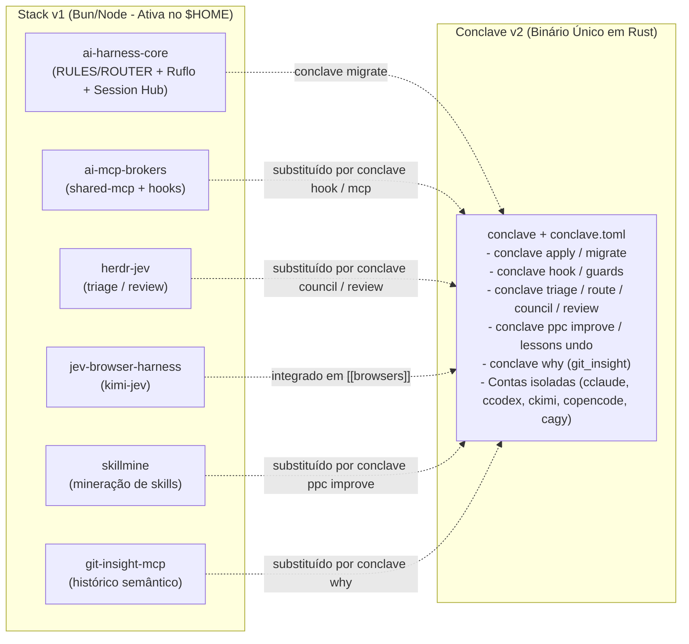
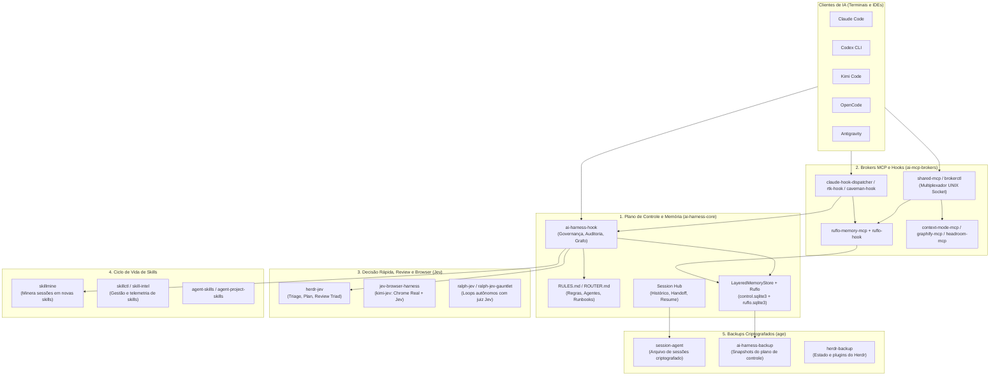

# AI Harness Labs

Ecossistema de controle, memória canônica em camadas (Ruflo), brokers MCP compartilhados, roteamento multi-modelo (Jev) e automação de skills para **Claude Code, Codex, Kimi, OpenCode e Antigravity**.

---

## Visão Geral: Stack v1 (Ativa no `$HOME`) vs Conclave v2 (Rust Unificado)

Hoje existem duas gerações na organização:

1. **Stack v1 (TypeScript / Bun / Node) - Ativa em produção no `$HOME`**:
   Composta por repositórios modulares (`ai-harness-core` + `ai-mcp-brokers` + `herdr-jev` + `skillmine` + `jev-browser-harness`). É a que responde pelos hooks atuais em `~/.local/bin/ai-harness-hook`, `~/.local/bin/claude-hook-dispatcher` e `~/.local/bin/ruflo-hook`.
2. **Conclave v2 (Rust) - Sucessor Unificado (`/home/martil/projects/personal/conclave`)**:
   Funde os repositórios da v1 em **um único binário nativo em Rust (`conclave`)** e um único arquivo declarativo (`conclave.toml`). Não escreve direto no `$HOME`: gera tudo isolado em `out/<target>/` e `homes/<cli>/<name>` (`cclaude`, `ccodex`, `ckimi`, `copencode`, `cagy`) com rotação automática de contas e migração direta da v1 via `conclave migrate`.



---

## Como a Stack v1 (Ativa hoje) se conecta



---

## Mapa dos 23 Repositórios por Função

### 1. Sucessor Unificado em Rust (v2)
| Repositório | O que faz | Caminho local principal |
| :--- | :--- | :--- |
| **[conclave](https://github.com/ai-harness-labs/conclave)** | Binário único em Rust (`conclave`) que unifica `ai-harness-core`, `herdr-jev`, `jev-browser-harness`, `skillmine`, `git-insight-mcp` e `session-agent` a partir de um `conclave.toml`, com isolamento de múltiplas contas (`cclaude`, `ccodex`, `ckimi`, `copencode`, `cagy`) sem tocar no `$HOME`. | `/home/martil/projects/personal/conclave` (`~/.local/bin/conclave`) |

### 2. Núcleo, Plano de Controle e Memória (v1 Ativa)
| Repositório | O que faz | Caminho local principal |
| :--- | :--- | :--- |
| **[ai-harness-core](https://github.com/ai-harness-labs/ai-harness-core)** | Coração da v1. Compila `RULES.md` e `ROUTER.md` para todos os clientes, gerencia a memória canônica (`LayeredMemoryStore` + `RufloMemoryAdapter`), auditoria (`governance.sqlite3`), histórico de sessões (`Session Hub`) e o binário `ai-harness` / `ai-harness-hook`. | `/home/martil/projects/personal/ai-harness-core` |
| **[harness-scripts](https://github.com/ai-harness-labs/harness-scripts)** | Scripts utilitários e CLIs pessoais registrados no plano de controle do AI Harness (`~/.local/bin`). | `/home/martil/projects/personal/harness-scripts` |
| **[spec-harness](https://github.com/ai-harness-labs/spec-harness)** | Desenvolvimento guiado por especificação sobre bases de código desconhecidas (grafo de código + mineração de histórico git). | Remoto |
| **[harness-depot](https://github.com/ai-harness-labs/harness-depot)** | Depósito auxiliar de artefatos e configurações do harness. | Remoto |

### 3. Brokers MCP e Hooks Compartilhados
| Repositório | O que faz | Caminho local principal |
| :--- | :--- | :--- |
| **[ai-mcp-brokers](https://github.com/ai-harness-labs/ai-mcp-brokers)** | Multiplexador MCP (`stdio-broker` / `brokerctl`) que mantém um único processo backend por serviço (`ruflo-memory`, `context-mode`, `graphify`, `headroom`) compartilhado entre vários terminais, além dos hooks (`claude-hook-dispatcher`, `ruflo-hook`, `rtk-hook`, `caveman-hook`). | `/home/martil/projects/personal/ai-mcp-brokers` (instalado em `~/.local/share/ai-mcp-brokers`) |
| **[git-insight-mcp](https://github.com/ai-harness-labs/git-insight-mcp)** | Servidor MCP para consultas semânticas no histórico Git (quem/o quê/quando/por quê em qualquer linha, arquivo ou branch). | `/home/martil/projects/personal/git-insight-mcp` |
| **[jev-mcp-hub](https://github.com/ai-harness-labs/jev-mcp-hub)** | Hub MCP para ferramentas Jev. | Remoto |

### 4. Ecossistema Jev (Triagem, Code Review, Browser e Loops)
| Repositório | O que faz | Caminho local principal |
| :--- | :--- | :--- |
| **[herdr-jev](https://github.com/ai-harness-labs/herdr-jev)** | CLI `herdr-jev`: faz triagem de complexidade (`herdr-jev triage`), roteamento de modelo/esforço e code review multi-escopo (`herdr-jev review --json`) integrado aos hooks do `ai-harness-core`. | `/home/martil/projects/personal/herdr-jev` |
| **[jev-browser-harness](https://github.com/ai-harness-labs/jev-browser-harness)** | Automação de navegador real (`kimi-jev`) combinando sessão logada do Chrome com decisões rápidas do TypeSafe Jev. | `/home/martil/projects/personal/jev-browser-harness` |
| **[ralph-jev](https://github.com/ai-harness-labs/ralph-jev)** | Loop autônomo de agentes com juiz de conclusão via TypeSafe Jev. | `/home/martil/projects/personal/ralph-jev` |
| **[ralph-jev-gauntlet](https://github.com/ai-harness-labs/ralph-jev-gauntlet)** | Evolução do `ralph-jev` com filtro de requisitos Jev e agente crítico cego (Gauntlet loop). | Remoto |

### 5. Skills (Mineração, Catálogo e Gestão)
| Repositório | O que faz | Caminho local principal |
| :--- | :--- | :--- |
| **[skillmine](https://github.com/ai-harness-labs/skillmine)** | CLI `skillmine`: analisa sessões recentes (Claude, Codex, Kimi, OpenCode, Antigravity) e extrai aprendizados repetitivos em novas skills/runbooks com suporte a `undo`. | `/home/martil/projects/personal/skillmine` |
| **[skillctl](https://github.com/ai-harness-labs/skillctl)** | Utilitário para gerenciamento e distribuição de skills entre clientes. | `/home/martil/projects/personal/skillctl` |
| **[skill-intel](https://github.com/ai-harness-labs/skill-intel)** | Análise e inteligência sobre uso e eficácia das skills. | `/home/martil/projects/personal/skill-intel` |
| **[agent-skills](https://github.com/ai-harness-labs/agent-skills)** | Catálogo de skills gerais compartilhadas entre agentes. | Remoto |
| **[agent-project-skills](https://github.com/ai-harness-labs/agent-project-skills)** | Skills específicas de projetos empacotadas para agentes. | Remoto |

### 6. Ecossistema Herdr (Console e Plugins)
| Repositório | O que faz | Caminho local principal |
| :--- | :--- | :--- |
| **[herdrm](https://github.com/ai-harness-labs/herdrm)** | Console nativo macOS para o Herdr (gerencia múltiplos agentes de código e terminais ao vivo entre dispositivos). | Remoto |
| **[herdr-clip-limpo](https://github.com/ai-harness-labs/herdr-clip-limpo)** | Plugin do Herdr que limpa texto copiado do terminal (remove barras laterais, quebras artificiais e preserva links/comandos). | `~/.local/share/herdr-plugins/clip-limpo` |
| **[herdr-waha](https://github.com/ai-harness-labs/herdr-waha)** | Integração Herdr com WhatsApp HTTP API (WAHA). | `/home/martil/projects/personal/herdr-waha` |

### 7. Backups e Arquivo Criptografado
| Repositório | O que faz | Caminho local principal |
| :--- | :--- | :--- |
| **[session-agent](https://github.com/ai-harness-labs/session-agent)** | Destino remoto criptografado (`archiveRemote` em `~/.config/ai-harness/history.json`) onde o `ai-harness` publica branches de sessões concluídas. | Configurado em `~/.config/ai-harness/history.json` |
| **[ai-harness-backup](https://github.com/ai-harness-labs/ai-harness-backup)** | Releases criptografadas de backup do estado e memória do AI Harness. | Remoto |
| **[herdr-backup](https://github.com/ai-harness-labs/herdr-backup)** | Backup privado e criptografado das configurações, fontes, plugins e estado do Herdr. | `/home/martil/projects/personal/herdr-backup` |

---

## Onde ficam os dados na máquina local (`~/.local` e `~/.config`)

- **Configuração de memória canônica**: `~/.config/ai-harness/memory.json`
- **Banco de controle (ledger, proveniência, recibos)**: `~/.local/state/ai-harness/canonical/control.sqlite3`
- **Banco de conteúdo e busca léxica/grafo (Ruflo)**: `~/.local/state/ai-harness/canonical/ruflo.sqlite3`
- **Banco de governança e auditoria**: `~/.local/state/ai-harness/control-plane/governance.sqlite3`
- **Snapshot rápido dos hooks**: `~/.local/state/ai-harness/control-plane/hook-control-plane-v1.json`
- **Artefatos compilados por cliente (`RULES.md`, `ROUTER.md`)**: `~/.local/share/ai-harness/generated/<cliente>/`
- **Brokers instalados em produção**: `~/.local/share/ai-mcp-brokers/`

---

## Comandos Rápidos do Dia a Dia

```bash
# --- Stack v1 (Ativa no $HOME) ---
ai-harness compile --write      # Recompila RULES.md / ROUTER.md
brokerctl status                # Verifica saúde dos brokers MCP compartilhados
brokerctl reconcile             # Limpa sockets órfãos de brokers antigos
ai-harness history              # Histórico unificado de sessões (Claude/Codex/Kimi/OpenCode)
herdr-jev triage "tarefa" --json
herdr-jev review --json

# --- Conclave v2 (Rust Unificado, sem sujar o $HOME) ---
conclave                        # Lista contas isoladas e navegadores MCP
conclave doctor                 # Verifica links, CLIs instalados e proveniência
conclave migrate                # Converte o plano de controle do ai-harness-core para conclave.toml
conclave plan && conclave apply # Gera configs isoladas em out/<target>/
```
